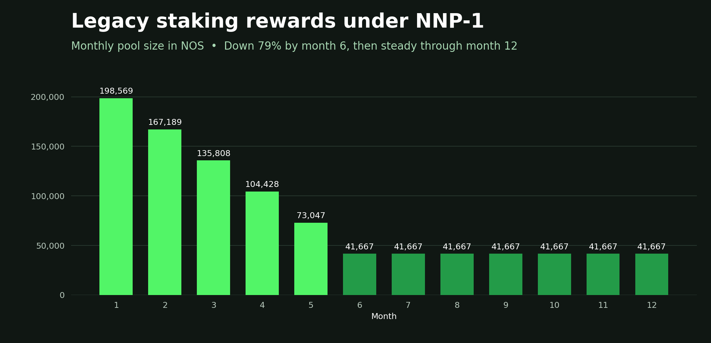
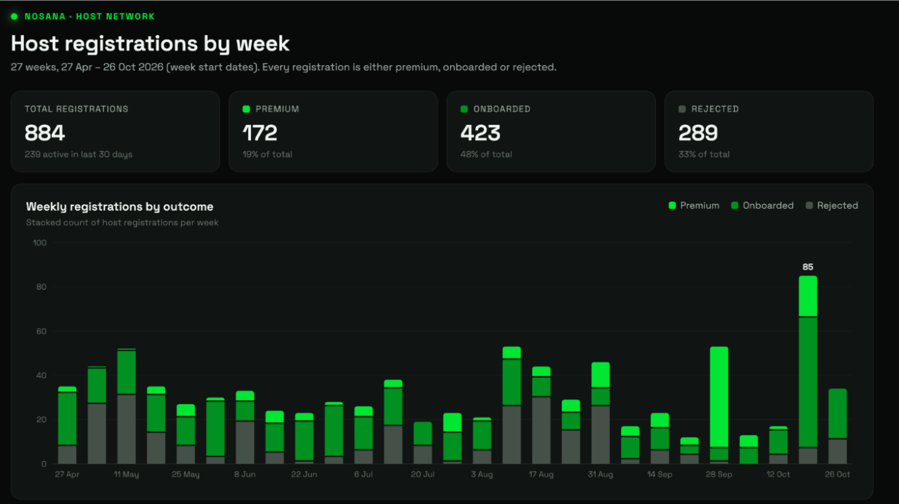
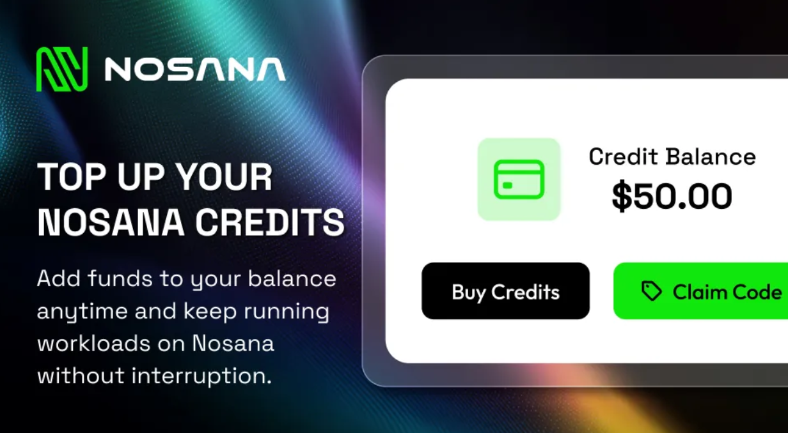

In November 2025, the Nosana community came together to shape and vote on NNP-001, its first network proposal. The vote set a new course for Nosana’s tokenomics by shifting from passive staking rewards to deliberate rewards for hosts and clients who add value to the network.

Putting that proposal into practice meant working through details the community had left open at the time of the vote. A year later, much of NNP-001 is live, and we can look at what the rollout has delivered so far and where the work goes next.

## **What the community voted for**

- Require GPU hosts to stake collateral based on their hardware’s earning potential.
- Retarget emissions toward Host Base Incentive Rewards and client rebates, while gradually phasing out passive staking rewards over 12 months.
- Introduce a host reputation score based on uptime, performance, and quality to determine reward eligibility and weight.

Read the [original NNP-1 proposal](https://github.com/nosana-ci/network-proposals/blob/main/nnp/NNP-0001-tokenomics.md).

## **Redirecting Token Emissions to Power Network Growth**

NNP-1 changed how Nosana uses token emissions. Under the legacy model, users earned rewards by staking NOS. The proposal laid out a 12-month transition toward incentives for hosts that keep GPUs available and customers that run workloads on the network.

Over those 12 months, we reduced legacy staking rewards according to the proposal’s schedule. Stakers who began unstaking received their tokens gradually over the release period they had chosen. Those who kept their tokens staked continued to earn rewards during the phaseout.

Legacy staking rewards conclude on November 28, 2026, after which remaining assets in the legacy smart contract will no longer generate yield.

**Action Required:** Users with tokens remaining in the legacy staking contract are advised to initiate the unstaking process. From November 28, 2026, staked tokens in this contract will no longer accumulate yield, and balances will be linearly streamed back to your connected wallet over your selected unstaking duration.

## **Expanding Host Capacity to Meet Customer Demand**

Driven by an insatiable appetite for AI compute, Nosana experienced a surge in client demand over the past year. To sustain network growth, expanding host supply quickly and onboarding high-quality providers became critical priorities.

To address this, NNP-1 introduced mechanics designed to attract and reward top-tier hosts, most notably Host Base Incentive Rewards. By offering a guaranteed income stream for remaining online, this mechanism effectively incentivizes hosts providing high-demand GPUs.

By September 2026, customer demand for RTX 4090 and RTX 5090 compute outpaced available supply. This milestone demonstrated strong application usage across the network, driving an immediate need for expanded capacity.

This high demand presents providers with expanded earning opportunities while emphasizing the necessity of reliable compute availability for growing client workloads. Aligning provider incentives with customer reliability remains central to Nosana's momentum.

In response, Nosana launched targeted provider campaigns, offering extra rewards to eligible RTX 4090 and RTX 5090 hosts on top of job earnings. By linking eligibility to daily uptime, the campaign directly reinforces operational readiness.

A similar strategy is currently deployed to support the onboarding of in-demand RTX PRO 6000 hosts.

## **Incentivizing Client Demand and Retention**

NNP-1 also set out to reward clients who run workloads on Nosana. Over the past year, that work has brought more ways to pay for compute and volume rebates that give clients an incentive to keep using the network. Clients can now pay with credit cards, USDC, or NOS. Credit card and USDC payments carry a 2% facilitation fee that goes to the protocol treasury. Payments in NOS carry no additional fee.

To support these payment options, Nosana introduced Compute Credits, giving clients a USD-pegged balance they can spend on workloads. This system delivers the functionality first outlined as _dNOS_ in NNP-001, with on-chain dNOS still ahead on the roadmap.

Since launching fiat payments, Nosana has processed more than **\$150,000 in client compute purchases**. For a newly introduced payment flow, this is an early sign of adoption backed by paying customers. Clients are putting the feature to work, establishing a foundation for further compute sales as the marketplace grows.

## **What’s Next for Nosana’s GPU Marketplace**

The next phase builds on what we’ve learned from running the marketplace over the past year. The remaining NNP-1 work focuses on host rewards and on-chain compute credits, alongside broader improvements to pricing and job scheduling.

### **Algorithmic Host Base Incentive Rewards**

We’re developing a system that adjusts host base rewards using network activity and GPU market rates. The aim is to direct incentives toward the capacity customers need and give providers a clearer reason to keep those GPUs available.

### **On-Chain dNOS Tokens**

Compute Credits already give clients a USD-pegged balance to spend on workloads. The next step is to bring that functionality on-chain through dNOS, building on the billing system clients use today.

### **Pricing That Responds to the Market**

Beyond the original scope of NNP-1, we’re working on pricing that responds to changes in GPU supply and customer demand. This will help the marketplace adapt as demand for different hardware grows.

### **Better Matching Between Jobs and GPUs**

We’re also improving how workloads reach suitable GPUs. Moving from on-chain job lists toward a matchmaking engine will allow more precise allocation based on workload requirements and provider capabilities.

### **A Stronger GPU Marketplace, Built for What’s Next**

A year after the vote, NNP-1 is shaping how Nosana’s GPU marketplace grows. The transition away from passive staking rewards is nearing completion, targeted host incentives are helping bring needed hardware onto the network, and clients have purchased more than \$150,000 in compute since fiat payments launched.

The next phase carries that work forward. More responsive rewards, on-chain compute credits, market-driven pricing, and better job matching will help connect growing customer demand with reliable GPU capacity. The community set the direction with NNP-001. Every provider keeping a GPU online and every client running a workload is helping turn that decision into a marketplace people can depend on.

## Useful Links

- [Nosana Website](https://nosana.com/)
- [Join the Discord](https://nosana.com/discord)
- [Follow us on X](https://nosana.com/x)
- [Nosana on GitHub](https://nosana.com/github)
- [Nosana Governance](https://vote.nosana.com/)
