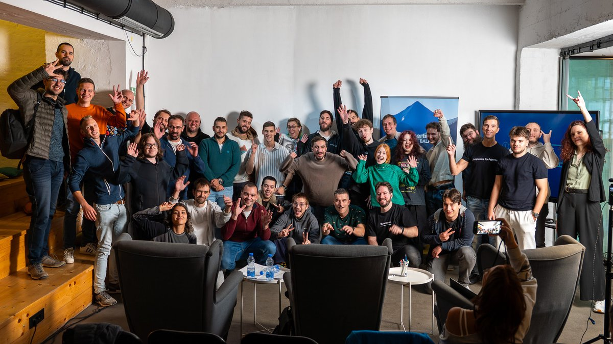

October brought a set of practical improvements to the way people build and operate on Nosana. Developers can now connect to running deployments over SSH, create API keys with specific permissions, and use a Claude Code skill to take a workload from job definition to live endpoint. In Discord, Nosa began helping builders and GPU providers find sourced answers from Nosana’s documentation and support history.

We also kept working on the supply side, where demand for RTX 4090 and RTX 5090 compute continues to outpace available capacity. Across the ecosystem, Nosana supported AI teams building in Belgrade, shared what grant recipients are making, and opened the grants program to new applications.

Here’s what happened in October.

## **Product**

### **SSH access for running deployments**

You can now connect to a Nosana deployment from your own machine using a standard SSH client. If you prefer to work in the browser, the dashboard and Nosana Kit also provide a terminal, with no local key setup required.

SSH gives developers a more direct way to inspect and work with a running environment after deployment. It adds a familiar tool to the workflow, whether you are troubleshooting a workload or interacting with it while it runs.

[Get started with SSH access](https://learn.nosana.com/api/manage-deployments.html)

### **More control over API keys**

API keys now support permissions. When creating a key, you can choose which actions it can perform, for example, giving a monitoring script read access to jobs and credits without allowing it to launch jobs or spend credits.

This makes it easier to use separate keys for separate tasks and limit each integration to the access it needs.

[Explore API key scopes](https://learn.nosana.com/api/scopes.html)

### **Nosa is live in Discord beta**

Nosa, Nosana’s AI community helper, launched in beta in the Discord server. It draws on Nosana documentation, SDK and CLI references, on-chain interfaces, and previously resolved support cases to answer questions about deploying workloads, running a GPU node, and using the network.

Nosa includes sources with its answers, so users can check the guidance themselves. When a question needs input from the team, it can make that clear and point users toward human support.

[Meet Nosa](https://www.nosana.com/blog/meet-nosa-your-ai-helper-for-deploying-and-hosting-on-nosana/)

### **Give your coding agent a path to Nosana**

The new Nosana skill for Claude Code helps a coding agent work through the deployment flow \- from defining a job to reaching a live endpoint. It brings Nosana’s GPU compute into the same environment where developers are already writing and working with code.

[Explore the Nosana Agent Skill](https://learn.nosana.com/agents/skill) · [View the Nosana Kit on GitHub](https://github.com/nosana-ci/nosana-kit)

## **Building on Nosana**

### **Grant recipients share what comes next**

In an October live conversation, AnveVoice and Voight discussed what they have built since receiving Nosana grants, what they are testing now, and what they plan to do next. Their projects show two different applications of GPU infrastructure: voice-enabled web apps and infrastructure for production AI agents on Solana.

The conversation also gave prospective applicants a closer look at the grant process and the work that can follow an award. Nosana Grants are open to new applications, offering $5,000–$50,000 in USDC, NOS, and GPU credits. Awards are milestone-based and non-dilutive, and builders keep ownership of what they create.

[Watch the full live session](https://x.com/i/broadcasts/1dGYlayzXDoKX) · [Learn about the Nosana Grants Program](https://nosana.com/grants/)

### **AI workloads for builders in Belgrade**

At Superteam Balkans’ Buildstation Belgrade, teams developed submissions for Crypto World’s Fair and used Nosana GPU credits to bring their AI ideas to life. Their projects ranged from AI agents to image and video generation, showing how decentralized GPU compute can support different kinds of builders. At Demo Day on October 20, teams presented what they had built.

### **New model deployment: Cloudflare Clef**

Nosana highlighted Cloudflare’s Clef models as ready-to-run deployments. Clef 27B is aimed at higher accuracy, while Clef Flash 9B is designed for lower latency. The models score candidate responses in one forward pass, making them useful for tasks such as routing support tickets, checking policies, and deciding which step an agent should take next.

[Try Clef on Nosana](https://nosana.com/gpu-workloads/)

## **GPU Providers**

### **More capacity for RTX 4090 and RTX 5090 workloads**

Demand for RTX 4090 and RTX 5090 compute remains ahead of available supply. In October, Nosana continued promoting an incentive for eligible providers: an additional amount equivalent to 20% daily utilization on top of earnings from customer workloads, for days when the host meets the campaign requirements, including at least 85% uptime.

The campaign is intended to bring more reliable high-end GPU capacity onto the network, giving customers more room to run demanding workloads while helping GPU owners put their hardware to work.

[See the campaign details and eligibility requirements](https://nosana.com/blog/rtx-4090-5090-gpu-provider-campaign/)

### **A practical route from Windows to Linux**

Nosana also published a guide for GPU owners who want to host but currently use Windows. It walks through installing Ubuntu alongside Windows using a dual-boot setup, so a gaming PC can keep its existing Windows environment while also being configured for Nosana’s Linux-based hosting requirements.

[Read the Windows-to-Linux host guide](https://www.nosana.com/blog/how-to-switch-from-windows-to-linux-and-become-a-nosana-gpu-provider/)

## **Ecosystem and Community**

### **Explaining how \$NOS connects compute and providers**

October’s token explainer looks at the practical relationship between the teams using GPU compute and the providers supplying it. Workload payments, provider earnings, and network incentives all sit within that relationship, with \$NOS connecting the two sides of the network.

[Read “The Token Behind the Compute”](https://www.nosana.com/blog/the-token-behind-the-compute/)

### **October Community Call**

The October Community Call brought the community together for a monthly update from the Nosana team. The recording is available for anyone who missed the live session or wants to catch up on the month’s announcements and discussion.

[Watch the October Community Call](https://www.youtube.com/live/x5yKFJ9h_uc)

## **Looking Ahead**

October made Nosana easier to work with at several points in the builder journey: finding technical answers, managing access, connecting to a live deployment, and moving from code to GPU compute with an AI coding assistant. At the same time, the network’s continued focus on RTX 4090 and RTX 5090 capacity reflects the need to keep expanding supply as demand grows.

With new grant applications open and builders already testing real workloads, there is more room for teams to take an idea from development to deployment on Nosana.

[Deploy an AI workload on Nosana](https://deploy.nosana.com/)

## Useful Links

- [Nosana Website](https://nosana.com/)
- [Join the Discord](https://nosana.com/discord)
- [Follow us on X](https://nosana.com/x)
- [Nosana on GitHub](https://nosana.com/github)
- [Nosana Grants Program Page](https://nosana.com/grants)
