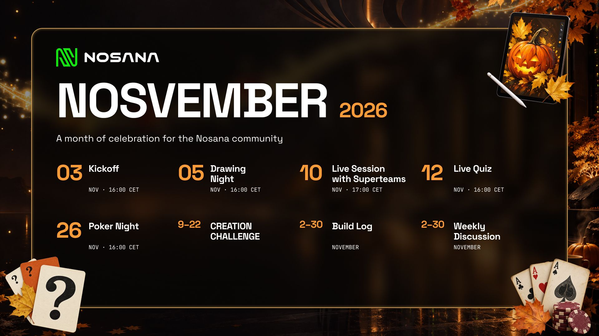

November is here, and NOSvember is back. From November 2 to 30, we’re bringing the Nosana community together for a month of live events, creative challenges, project stories and recognition. Discord is our home base, with the kickoff, a guest AMA with Superteams and the closing ceremony live on X. Builders, creators, longtime members and newcomers are all invited to join in and celebrate the people who make this community special🤖.

Last year’s NOSvember brought the community together through games, creative activities and live events. This year, we’re building on that energy with more ways to take part, more space to share what the community is making, and recognition for the people who help others feel welcome and involved.

First, join the [Nosana Discord](https://discord.gg/xsGFveut2p) to stay on top of every activity, get the instructions and catch all the updates. Below, you’ll find the full programme for the month, so you can see what’s coming and plan how you want to take part. Brace yourself; there’s a lot to celebrate.

[Join the Nosana Discord](https://discord.gg/AKpKJPheVX)

## **All month: Weekly discussions and Build Logs**

From November 2 to 30, weekly discussion threads in Discord will invite the community to talk about AI, compute, DePIN and Nosana. Each thread brings a new open question, so you can join with an idea, an experience or a point of view. Contributions that make the conversations engaging and useful will be highlighted in the weekly recaps.

The NOSvember Build Log runs throughout the month on the [Nosana subreddit](https://www.reddit.com/r/Nosana_AI/). Share your project as its own new post, using the **Build log** flair. Tell the community what your project does, how it uses Nosana and what you’ve learned. Screenshots, demos, sample outputs and repository links are welcome. Existing projects count, so there’s no need to start something new or post weekly updates.

Entries will be judged on clarity, usefulness and demonstrated use of Nosana. Upvotes don’t count. The Build Log has a **\$500+ reward pool**, made up of \$NOS tokens and GPU credits, and winners will be announced at the November 30 Recognition Ceremony.

## **Tuesday, November 3 at 16:00 CET: Kickoff call**

NOSvember officially gets underway with a live kickoff on X and Youtube. We’ll introduce the month’s activities, explain how to join and show you where to find everything in Discord. It’s a chance to meet fellow participants and get the celebration started together, whether you’ve been part of Nosana for years or have just arrived.

[Set a reminder for the kickoff here](https://www.youtube.com/watch?v=naHpAwOPaSY)

## **Thursday, November 5 at 16:00 CET: Drawing Night**

Join the community in Discord on November 5 at 16:00 CET for Drawing Night on Sketchful. Take turns drawing and guessing, meet other Nostronauts in voice chat, and see what happens when everyone tries to interpret the same prompt. No drawing experience is needed; the fun is in playing together. Standout moments and contributions will be recognised in the community recap.

[Join the Nosana Discord to participate in the challenge](https://discord.gg/AKpKJPheVX)

## **November 9–22: Creation Challenge**

The NOSvember Creation Challenge opens on November 9 and runs through November 22\. Choose one of two categories: **Explainer**, for a thread or short article that helps people understand Nosana or DePIN, or **Creative**, for a meme, visual or short video inspired by the ecosystem.

To enter, publish one original piece in your X feed or the CMC feed, then submit the link in the [Discord submissions channel.](https://discord.gg/AKpKJPheVX) If you post on X, include **\#NOSvember** and **\#CreatorChallenge**. CMC entries don’t need hashtags. The judging panel will review entries from November 23 to 27, assessing them for clarity, accuracy, originality and usefulness. Upvotes and reach won’t count toward the results.

The panel will select the top three explainers and one creative entry. Selected creators will receive \$NOS rewards, and standout work may be featured across Nosana channels. Winners will be announced at the November 30 Recognition Ceremony.

## **November 12: Live Quiz**

On November 12, put your Nosana, DePIN and AI knowledge to the test in a live Discord Quiz. We’re bringing back last year’s favorite community activity. Play along, learn something new and cheer on the rest of the community as the questions unfold. The top three participants will receive small \$NOS thank-yous.

[Join the Nosana Discord](https://discord.gg/AKpKJPheVX)

## **November 10: Build Local, Launch Global with Superteams**

Three Superteams. One conversation. New opportunities across Solana. On November 10, Nosana brings Superteam Spain, Superteam Netherlands and Superteam Balkans together **live on Discord and YouTube** to explore how builders can find their first users, connect with collaborators and take their products across borders. We’ll discuss turning hackathon momentum into lasting progress and tapping into the networks helping Solana projects grow. Bring your questions and what you’re building.

[**Set a reminder here**](https://luma.com/b04u0udq)

## **November 23–27: Challenge judging and Champion nominations**

From November 23 to 27, the judging panel will review Creation Challenge entries for clarity, accuracy, originality and usefulness. The selected creators will be announced at the November 30 Recognition Ceremony.

Community Champions are returning this year to recognise the people who help make Nosana’s community special. We’ll share more about the titles soon.

## **November 26: Poker Night**

Poker Night brings the community together in Discord on November 26 for one final game before the closing celebration. There’s no buy-in, and each participant gets one seat. Top finishers will receive prizes, while everyone gets a chance to play, connect and enjoy the game.

## **November 30: Final recap and Recognition Ceremony**

On November 30, the final weekly recap will look back at the projects, conversations and community moments that shaped NOSvember. We’ll close the month live on X with a Recognition Ceremony celebrating this year’s Champions and everyone who helped make the celebration special.

Champions receive a permanent **Champion 2026** role and an invitation to stay involved after November. Depending on their interests, they may help welcome new members, co-host a discussion, review community work or share feedback with the team. NOSvember is a month-long celebration, and the connections made along the way can keep growing into December and beyond.

## **Join the celebration [here](https://discord.gg/AKpKJPheVX)**

Join the Nosana Discord, find the NOSvember channels and take part at your own pace. Share a project, enter the Creation Challenge, join a game or add your perspective to a discussion. Every contribution helps make the Nosana community what it is. See you in NOSvember\! 🎉

## Useful Links

- [Nosana Website](https://nosana.com/)
- [Join the Discord](https://nosana.com/discord)
- [Follow us on X](https://nosana.com/x)
- [Nosana on GitHub](https://nosana.com/github)
- [Nosana Grants Program Page](https://nosana.com/grants)
